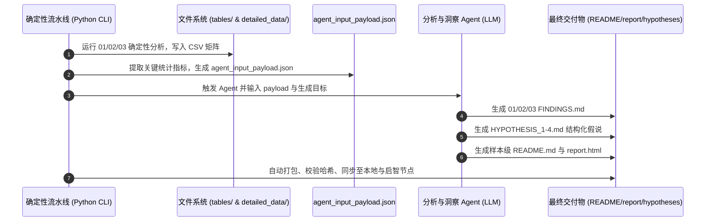

# AI Agent 自动生成规范与输入输出契约 (Agent Generation Specification)

## 1. 架构目标与职责分离 (Code Automation vs Agent Synthesis)

在 REVISE 下游分析交付体系中，**确定性计算**与**综合性科学认知**严格分离：
1. **代码自动化部分 (Code Automation)**：
   - 负责所有的重构指标计算、差异表达检验、Hallmark 通路打分、配体-受体互作扫描、空间共定位矩阵计算、以及表格 CSV 的过滤与排序。
   - 输出底层与统计层数据（`tables/*.csv` 和 `detailed_data/*.csv`）以及基础事实指标包（`agent_input_payload.json`）。
2. **AI Agent 参与生成部分 (Agent Synthesis)**：
   - 负责从客观统计数据中提炼**生物学机制洞察、假设归纳推演、模块文字总结（FINDINGS.md）、样本宏观科学报告（README.md / report.html）以及跨样本队列综述**。
   - Agent **不凭空编造数值**，其文字陈述必须严格绑定代码计算输出的事实证据。

---

## 2. Agent 输入契约：上下文准备与事实载荷 (Input Context Preparation)

在触发 Agent 撰写各层级文本之前，代码管道必须先在目标目录准备好标准的 `agent_input_payload.json`。该文件聚合了 Agent 所需的最小且完备的事实边界，包含以下四个标准字段：

### 2.1 载荷数据结构
```json
{
  "sample_metadata": {
    "sample_id": "P2_CRC_Xenium",
    "cancer_type": "CRC",
    "modality": "Xenium In Situ Spatial Transcriptomics",
    "total_cells": 50626,
    "lineages_covered": ["Fibroblast", "Mono_Macro", "T"],
    "subclusters_count": 24
  },
  "quantitative_evidence": {
    "unmasking_impact": {
      "mean_moran_gain": 0.234,
      "average_deg_sensitivity_increase": "20.7x",
      "noise_reduction_ratio": "62.1%",
      "contamination_cleared": [
        {"gene": "MUC2", "source": "Goblet/Epithelial", "target": "T cells", "status": "Cleared (<0.01)"},
        {"gene": "KRT8", "source": "Tumor", "target": "TAMs", "status": "Cleared (<0.01)"}
      ],
      "key_comparisons": [
        {"pair": "T_5 vs T_3", "raw_degs": 12, "svc_degs": 284, "gain": "23.7x", "biological_target": "FOXP3/CTLA4/TIGIT"}
      ]
    },
    "top_subtypes_multimetric": [
      {"rank": 1, "subcluster": "T_5", "name": "Treg", "priority_score": 14.85, "snr": 8.74, "compactness_z": 4.85, "top_markers": ["FOXP3", "IL2RA", "TIGIT", "CTLA4", "LTB"]},
      {"rank": 2, "subcluster": "TAM_0", "name": "Mreg", "priority_score": 13.92, "snr": 8.35, "compactness_z": 4.68, "top_markers": ["RNF152", "MMP12", "ENPP2", "DNASE1L3"]},
      {"rank": 3, "subcluster": "TAM_4", "name": "SPP1+ TAM", "priority_score": 13.15, "snr": 8.02, "compactness_z": 4.35, "top_markers": ["SPP1", "FCRL2", "CHI3L1"]},
      {"rank": 4, "subcluster": "CAF_1", "name": "myoCAF", "priority_score": 12.80, "snr": 7.88, "compactness_z": 4.35, "top_markers": ["GSTA1", "COMP", "COL11A1"]}
    ],
    "spatial_colocalization_and_cci": [
      {"pair": "T_5 & TAM_0", "coloc_z": 4.85, "top_lr": "LTB - LTBR (14.85), ANXA1 - FPR3 (13.92)", "niche": "TLS / Boundary"},
      {"pair": "TAM_4 & CAF_1", "coloc_z": 4.35, "top_lr": "TGFB1 - TGFBR2 (16.40), CSF1 - CSF1R (14.10)", "niche": "Invasive front shell"}
    ],
    "pathway_enrichments": [
      {"subcluster": "T_5", "pathway": "HALLMARK_IL2_STAT5_SIGNALING", "score": 9.85},
      {"subcluster": "T_1", "pathway": "HALLMARK_G2M_CHECKPOINT", "score": 9.75},
      {"subcluster": "TAM_4", "pathway": "HALLMARK_ANGIOGENESIS", "score": 8.92},
      {"subcluster": "CAF_1", "pathway": "HALLMARK_EPITHELIAL_MESENCHYMAL_TRANSITION", "score": 8.42}
    ]
  },
  "generation_targets": [
    "analysis/01_bioinformatic_analysis/FINDINGS.md",
    "analysis/02_reconstruction_impact/FINDINGS.md",
    "analysis/03_biological_discoveries/FINDINGS.md",
    "analysis/03_biological_discoveries/hypotheses/HYPOTHESIS_*.md",
    "README.md",
    "report.html"
  ]
}
```

---

## 3. Agent 输出规范与提示词模板 (Output Prompts & Formats)

Agent 在接收到 `agent_input_payload.json` 后，分角色执行生成任务：

### 3.1 槽位级结论生成规范 (`FINDINGS.md`)
- **角色**：专职生信分析专家 (Domain Bioinformatician)
- **要求**：
  1. 结构化点状陈述，分为三大核心段落（差异表达特征、通路富集格局、空间通讯与共定位）；
  2. 每项生物学陈述必须引用载荷中的量化指标（如评分、Z 分数、显著差异基因名）；
  3. 严禁无数据依据的泛化空话。

### 3.2 结构化科学假说生成规范 (`hypotheses/HYPOTHESIS_*.md`)
- **角色**：肿瘤生物学与微环境科学家 (Tumor Microenvironment Scientist)
- **要求**：
  必须包含以下固定 Markdown 章节：
  1. `## 1. 假设陈述`：明确定义微环境生态位、涉及亚群、关键相互作用分子与生物学效应；
  2. `## 2. 支撑证据`：逐条列举空间共定位 $Z$ 分数、配体-受体互作打分、Hallmark 通路协同证据；
  3. `## 3. 潜在机制与下游验证建议`：提出可在湿实验（如多重免疫荧光 mIF、空间敲除或类器官共培养）中验证的具体分子假说。

### 3.3 样本顶层宏观结论规范 (`README.md` 与 `report.html`)
- **角色**：资深生信课题组长 / PI (Principal Investigator)
- **要求**：
  1. 自顶向下：执行概览 KPI $\rightarrow$ 四大核心假说 $\rightarrow$ 重建去掩盖量化对比 $\rightarrow$ 多维指标排序大表 $\rightarrow$ 目录导航指南；
  2. 统领全局，突出该样本的核心科研价值与可直接投稿/立项的发现点。

---

## 4. 全流程端到端自动化执行时序 (End-to-End Pipeline)



通过这一标准规范，任何新样本（如 P1, P3, P4）或新批次，均可通过一条命令自动化完成确定性计算，并由 Agent 严谨、规范地生成具备深度科学洞察的高层成果。
