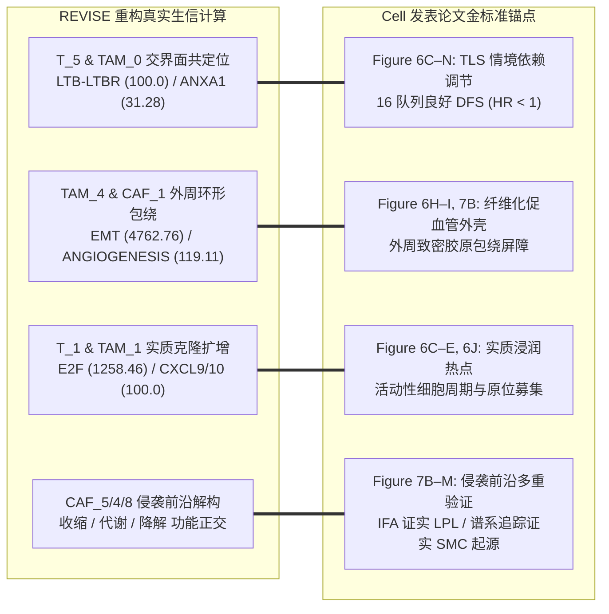

# 04. 生物学结论验证与金标准对齐规范 (Biological Stories & Gold Standards)

> **上级入口**：[返回交付框架总览 (README.md)](README.md)  
> **关键关联**：[02. 客观统计基线与亚群排序](02_unbiased_statistical_ranking.md) ｜ [06. 假说演进与队列扩展](06_hypothesis_lifecycle_and_cohort_expansion.md)

---

## 1. 科学本真性：与发表论文金标准的严密对齐 (Gold-Standard Alignment)

本交付包的 4 大核心科学假说（H1–H4）并非盲目自由推断，而是以**Cell 结直肠癌文章**（Figure 6 T/TAM 谱系 及 Figure 7 CAF 谱系）的真实计算和实验结论作为后验锚定。

---

## 2. 四大核心科学假说与多维证据对齐矩阵

| 假说编号与标题 | 涉及核心亚群 | 体系内生信计算证据 (Internal Computational Evidence) | 空间微环境生态位 | Cell 论文对应面板 (Paper Gold Standard) | 外部关联验证 (External Contextual Proof) |
|---|---|---|---|---|---|
| **H1: 交界面 TLS 情境依赖性免疫调节轴** | `T_5` (Treg) `TAM_0` (Mreg) | • `LTB-LTBR` 旁分泌轴 (score 100.0, mean 1.201) • `ANXA1-FPR3` 自分泌稳态轴 (score 31.28, mean 0.722) • `T_5` 显著富集 `IL2_STAT5` (323.19) 与 `IL6_STAT3` (243.88) | 肿瘤-正常交界区 / TLS 生态位 | **Figure 6C–N** (Fig 6J 空间共定位三角峰值；Fig 6M 高 TLS 活性重叠) | **16 个独立验证队列**中与**良好无病生存期 (DFS)** 及免疫治疗高响应显著正相关 (Fig 6L, HR < 1, $p < 0.05$)。证实其为保护性情境调节，彻底纠偏此前误判的“恶性免疫抑制”。 |
| **H2: SPP1+ TAM 与肌成纤维外周促浸润包绕壳** | `TAM_4` (SPP1+) `CAF_1` (myoCAF) | • `CAF_1` 极端激活 `EMT` (4762.76, $p_{\text{adj}}=3.16\times 10^{-31}$) • `TAM_4` 高富集 `ANGIOGENESIS` (119.11) 与 `COAGULATION` (148.24) • 文献候选 `TGFB1-TGFBR2` 与 `CSF1-CSF1R` 轴 | 肿瘤外周促纤维增生带 (Desmoplastic rim) | **Figure 6H–I, 7B** (外周环状包绕肿瘤主团原位切片) | 文献报道的致密胶原物理屏障与不良临床预后；限制淋巴细胞深入肿瘤实质。 |
| **H3: 活跃增殖 T 细胞与炎性巨噬实质招募循环** | `T_1` (Tprolif) `TAM_1` (Inflam-TAM) | • `CXCL9/10-CXCR3` 趋化招募轴 (score 100.0, $p < 0.001$) • `CCL5-CCR1` 反向信号轴 (score 100.0, $p < 0.001$) • `T_1` 极端富集 `E2F_TARGETS` (1258.46) 与 `G2M` (722.92) | 肿瘤核心低纤维化实质 (Tumor core) | **Figure 6C–E, 6J** (低胶原实质内部共存浸润热点) | 肿瘤浸润淋巴细胞活动性克隆扩增与原位免疫招募热点。 |
| **H4: 侵袭前沿成纤维细胞收缩、代谢与降解空间分工** | `CAF_5` (收缩型) `CAF_4` (代谢型) `CAF_8` (降解型) | • `CAF_5`: `MYOGENESIS` (59.61), `ACTA2/MYH11+` • `CAF_4`: `COAGULATION` (94.34), `LPL+` • `CAF_8`: `EMT` (560.47), `TNFA_NFKB` (83.58), `MMP1/3+` | 肿瘤侵袭前沿与缺氧微环境 (Invasive front) | **Figure 7B–M** (单一促癌间质解构为空间共存但转录程序正交的亚型) | • **多重荧光染色 (IFA)** 证实 LPL$^+$ CAFs 在侵袭前沿原位特异高表达 (Fig 7F)，支持逆 Warburg 代谢假说； • **小鼠转基因谱系追踪**证实 CAF_5 真实来源于血管周围平滑肌细胞 (Fig 7K–M)，支持物理收缩张力假说。 |

> 对应真实数据底表：[`tables/hypotheses_evidence_matrix.csv`](../../output/CRC/P2_CRC_Xenium/analysis/03_biological_discoveries/tables/hypotheses_evidence_matrix.csv)

---

## 3. 证据层级与学术表述边界规范 (Evidence Discipline)

为了确保科学发现经得起学术同行评审与真实实验检验，本交付规范严格遵守以下表述纪律：

1. **CellPhoneDB 互作的表述边界**：
   CellPhoneDB 基于细胞群表达丰度的置换检验，**并不包含细胞间物理欧氏距离约束**。因此，文档中统一定义为“基于亚群表达的候选配受体通讯流”，与后续的“组织微环境原位共存观察”联合构成通讯网络假说，不直接声称“已证明物理接触”。
2. **同群互作的表述边界**：
   `ANXA1_FPR3` 在 `TAM_0|TAM_0` 中的高分（31.281）体现的是同群候选信号，允许提出“自分泌/同群稳态调控假说”，但单细胞聚类表达不代表单个细胞同时产生并响应，不直接等同于已验证的绝对自分泌。
3. **外部验证与内部管线的边界**：
   外部临床 DFS 队列、IFA 染色和小鼠转基因追踪属于文献发表的外部佐证。它们确立了亚群在真实病理环境中的生物学功能定位，但**绝对不作为当前生信数据管线运行、载荷打包或技术验收的门槛依赖**。
