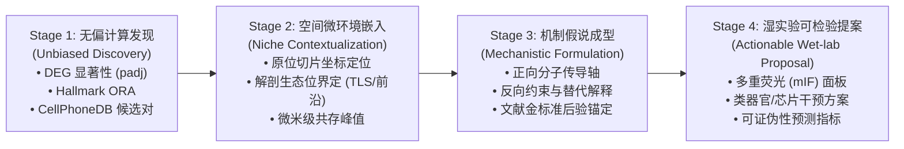
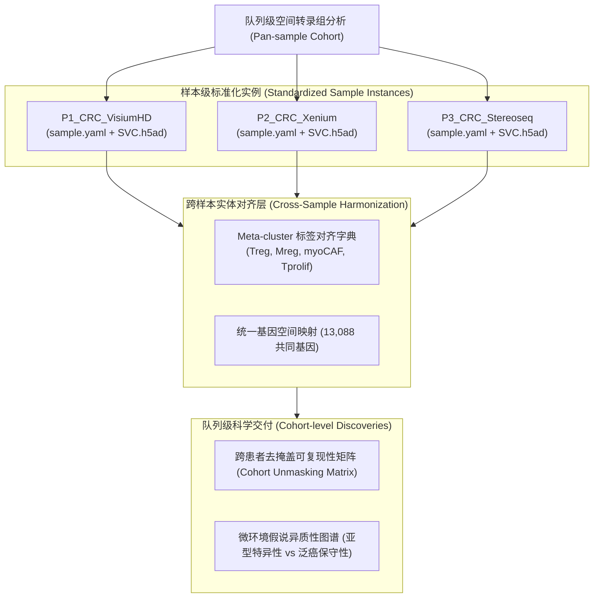

# 06. 科学假说演进与队列扩展范式规范 (Hypothesis Lifecycle & Cohort Expansion)

> **上级入口**：[返回交付框架总览 (README.md)](README.md)  
> **关键关联**：[04. 生物学故事与文献对齐](04_biological_validation_and_stories.md) ｜ [05. Agent 数据契约与载荷规范](05_agent_data_contract_and_payload.md)

---

## 1. 科学假说成熟度生命周期模型 (Hypothesis Maturation Lifecycle)

在自主科学发现系统中，一个生物学假说不能仅仅停留在“统计相关性发现”，而必须经历四个严密的渐进成熟阶段，最终输出可被湿实验直接验证的具体提案：

### 四阶段成熟度规范说明

1. **Stage 1: 无偏计算发现 (Unbiased Computational Discovery)**
   * **输入**：全谱系差异表达分析与通路富集矩阵；
   * **准入标准**：核心标记基因经过严格假设检验校正（$p_{\text{adj}} < 0.05$）；ORA 通路具有明确的基因集支撑；受配体通讯经过置换检验显著（$p < 0.001$）。
2. **Stage 2: 空间微环境嵌入 (Spatial Niche Contextualization)**
   * **输入**：细胞空间坐标与解剖区域标注；
   * **准入标准**：发现的分子特征必须在空间物理切片中具有明确的解剖归属（例如：`T_5/TAM_0` 归属于肿瘤-正常交界面及 TLS 生态位，而非抽象存在于全组织均质空间）。
3. **Stage 3: 机制假说成型 (Mechanistic Formulation & Boundaries)**
   * **输入**：多维计算证据整合；
   * **准入标准**：假说必须包含**正向分子轴**（如 `LTB-LTBR`）、**反向生物学约束**（如排除单纯促癌抑制的证据，提供 DFS 保护性证据）以及**替代解释的排除**。
4. **Stage 4: 湿实验可检验提案 (Actionable Wet-lab Proposals)**
   * **输出**：面向实验生物学家的行动提案，必须包含具体的抗体组合与可测量的对照指标（如下表所示）。

### 基于四大假说的湿实验提案对照表

| 假说编号 | 靶向假说主题 | 推荐验证技术 | 推荐抗体 / 分子检测面板 | 关键预测与成功判定标准 (Success Criteria) |
|---|---|---|---|---|
| **H1** | Treg-Mreg 交界面 TLS 保护性调节轴 | 多重免疫荧光 (mIF) | `[CD3, FOXP3, CD68, MMP12, LTB, PNAd, DAPI]` | 证实 FOXP3$^+$ Treg 与 MMP12$^+$ Mreg 在 PNAd$^+$ TLS 结构内部发生近距离物理接触（$<20\mu m$） |
| **H2** | SPP1+ TAM 与肌成纤维外周包绕壳 | 空间共聚焦成像 + 胶原定量 | `[CD68, SPP1, ACTA2, COMP, COL1A1, DAPI]` | 证实 SPP1$^+$ TAM 与 COMP$^+$ myoCAF 紧密交织包绕在肿瘤边缘，且该带胶原纤维密度显著高于实质 |
| **H3** | 增殖 T 细胞与炎性巨噬实质招募循环 | 微流控趋化小室实验 | `[CXCL9, CXCL10, CXCR3 抑制剂 (AMG487)]` | 添加 CXCR3 拮抗剂显著抑制 Tprolif 细胞向实质 TAM 聚集小室的迁移能力 |
| **H4** | 侵袭前沿成纤维细胞功能分工 | 多重 IFA + 靶向代谢组学 | `[ACTA2, MYH11, LPL, MMP1, MMP3]` | 证实 LPL$^+$ 细胞与 MMP1/3$^+$ 细胞在侵袭前沿呈现空间微区共存但蛋白表达互斥 |

---

## 2. 多样本与队列级扩展范式 (Cohort Scalability Paradigm)

当前 P2 样本的交付架构已完全模块化，可直接无缝扩展至更多患者切片（如 P1、P3）、不同空间技术（Visium HD、Stereo-seq）乃至跨癌种队列：

### 跨样本扩展规范要点

1. **样本级独立配置契约 (`sample.yaml`)**：
   每个样本目录维护自包含的 `sample.yaml`，清晰声明输入文件、空间坐标微米比例尺（`microns_per_unit`）、技术平台与谱系大类映射规则，保证单样本分析的自洽性。
2. **跨样本亚群元标签映射 (Meta-cluster Harmonization)**：
   不同切片聚类得到的亚群编号（如 P2 的 `T_5` 与 P1 的 `T_3`）通过元标签映射字典（Meta-cluster Map）统一对应到标准生物学实体（如 `CD4_Treg_FOXP3`），使下游 Agent 能够在队列层面上开展跨患者横向对比。
3. **队列级去掩盖增益矩阵 (Cohort Unmasking Reproducibility)**：
   通过汇总各样本的 `raw_vs_svc_unmasking_evidence.csv`，构建队列级去掩盖矩阵，评估特定假说（如 Treg-Mreg 轴或 CAF 空间分工）在不同患者间是“普遍保守”还是“患者特异”。
