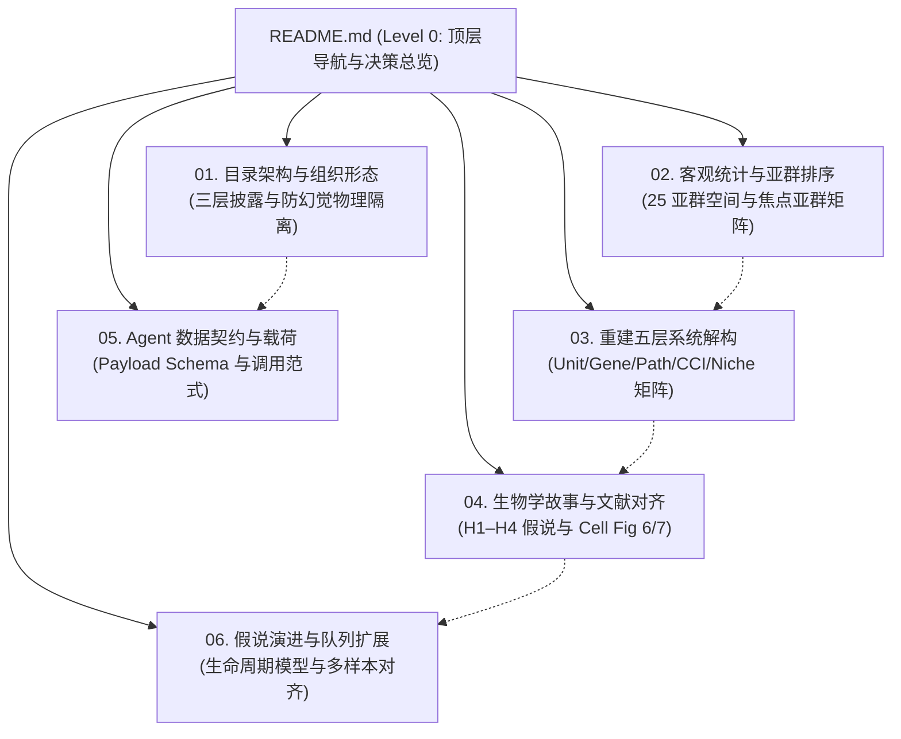

# REVISE 分析交付框架与规范体系 (Delivery Specification Framework)

> **核心使命**：系统化刻画单细胞超分辨率重构（REVISE）为空间转录组带来的信息解脱与去掩盖价值，并为下游 AI Agent 进行自主科学发现建立坚实、可信、抗幻觉的认知基建。

---

## 1. 渐进式披露架构与阅读地图 (Progressive Disclosure Map)

本套文档采用**倒金字塔渐进式披露（Progressive Disclosure）**哲学构建。顶层（本页）提供宏观决策全景与六大维度摘要；深层提供工程拓扑、统计底表、生物学金标准及 AI 数据契约的精细化下钻文档。

### 三类读者的推荐阅读路径

* **路径 A：学术评审专家 / PI**  
  `README.md (本页)` $\rightarrow$ [`04. 生物学结论验证与金标准对齐`](04_biological_validation_and_stories.md) $\rightarrow$ [`03. 重建五层系统解构`](03_five_layer_reconstruction_impact.md) $\rightarrow$ 审阅实机大屏 [`report.html`](../../output/CRC/P2_CRC_Xenium/report.html)。
* **路径 B：生信计算工程师 / 质控人员**  
  `README.md (本页)` $\rightarrow$ [`02. 客观统计基线与亚群排序`](02_unbiased_statistical_ranking.md) $\rightarrow$ [`03. 重建五层系统解构`](03_five_layer_reconstruction_impact.md) $\rightarrow$ 校验数据底表 [`analysis/`](../../output/CRC/P2_CRC_Xenium/analysis/)。
* **路径 C：AI Agent 架构师 / 下游开发者**  
  `README.md (本页)` $\rightarrow$ [`01. 交付架构与目录形态`](01_architecture_and_directory_layout.md) $\rightarrow$ [`05. 面向 Agent 消费的数据契约`](05_agent_data_contract_and_payload.md) $\rightarrow$ [`06. 假说演进与队列扩展`](06_hypothesis_lifecycle_and_cohort_expansion.md)。

---

## 2. 六大核心板块快速索引表

| 专题规范文档 | 核心定位与解决的问题 | 关键交付产物与底表支撑 |
|---|---|---|
| [**01. 目录架构与组织形态**](01_architecture_and_directory_layout.md) | 阐述倒金字塔三层物理目录、Token 预算控制（40KB 载荷）与防幻觉隔离机制 | `report.html` `agent_input_payload.json` `analysis/` 三槽位结构 |
| [**02. 客观统计与焦点亚群排序**](02_unbiased_statistical_ranking.md) | 建立 25 个重建亚群宇宙全景，阐明 8 大核心焦点亚群的真实生信统计特征 | `notable_subtypes_summary.csv` `focal_subtypes_top_degs.csv` |
| [**03. 重建五层系统解构矩阵**](03_five_layer_reconstruction_impact.md) | 系统化解答“重建改变了什么”：从 422 探针扩增至 13,088 基因，DEG 提升 18.6x，微环境正交解耦 | `systemic_impact_5layers.csv` `raw_vs_svc_unmasking_evidence.csv` |
| [**04. 生物学故事与文献对齐**](04_biological_validation_and_stories.md) | 深入论述四大科学假说（H1–H4），与 Cell 论文 Fig 6/7 全方位对齐，严密界定内外部证据层级 | `HYPOTHESIS_1~4.md` `hypotheses_evidence_matrix.csv` |
| [**05. Agent 数据契约与载荷规范**](05_agent_data_contract_and_payload.md) | 定义机器可消费的标准化 JSON Payload Schema，提供 Prompt 调用引导与边界约束 | `prepare_agent_payload.py` `agent_input_payload.json` |
| [**06. 假说演进与队列扩展范式**](06_hypothesis_lifecycle_and_cohort_expansion.md) | 提出从计算发现到湿实验提案的 4 阶段成熟度模型，确立单样本向队列泛化的标准实体映射 | `sample.yaml` 模板 Meta-cluster 实体对齐表 |

---

## 3. 核心设计原则摘要 (Executive Guiding Principles)

1. **绝对的事实同源性 (Ground Truth First)**：
   顶层大屏、JSON 载荷、Markdown 文档中的每一个分子、每一个通路数值与统计量，均必须 100% 溯源到底层真实生信计算 CSV 表格，严禁人工公式构造伪指标或硬编码断言。
2. **严密的证据层级划分 (Evidence Boundary Discipline)**：
   严格区分“体系内生信计算证据（已计算）”与“外部文献对照（关联验证）”。临床队列生存期（DFS）、多重荧光染色（IFA）和小鼠转基因谱系追踪属于文献背景支撑，不作为生信分析管线的内部运行依赖。
3. **空间情境贯穿始终 (Spatial Niche as Context)**：
   从单细胞亚型、分子标记到受配体通讯，均紧密嵌入到肿瘤-正常交界区（TLS 生态位）、外周纤维壳（Desmoplastic rim）或实质浸润区等微环境物理坐标中，避免脱离解剖结构的抽象分析。
4. **面向 Agent 消费的确定性防幻觉设计 (Deterministic Agent Infrastructure)**：
   通过分层隔离与结构化 JSON Payload，使下游科学发现 Agent 能够在受控的事实边界内进行逻辑推理与实验设计，杜绝因海量非结构化文本注入引发的认知漂移。
