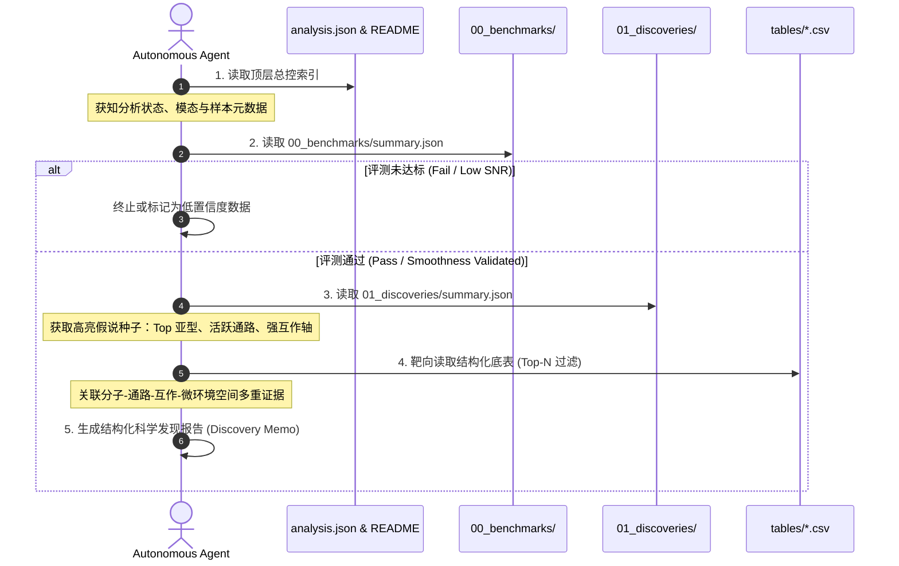

# 03. Agent 自主科学发现工作流规范（Agent Discovery Workflow）

## 一、 工作流设计目标

本规范定义了外部 AI Agent（如主控 Agent、生信分析 Agent、药物靶点挖掘 Agent）在接入一个已完成分析的样本槽位（`output/<group>/<sample>/analysis/`）时，**如何以最少 Token 消耗、最高证据置信度、零人工干预地自主完成科学发现**。

---

## 二、 四阶段自主发现状态机（Four-Phase Discovery Loop）



---

## 三、 各阶段具体执行与代码范式

### 阶段 1：质控与可信度门禁（Quality Gate）
Agent 首先检查数据重建本身是否成立，避免基于白噪声做虚假发现：
1. **调用动作**：
   ```python
   bm_summary = json.load(open("analysis/00_benchmarks/summary.json"))
   assert bm_summary["verdict"] == "pass", "Reconstruction quality failed gate."
   assert bm_summary["spatial_continuity"]["positive_gain_fraction"] > 0.75
   ```
2. **决策裁定**：
   若平滑先验生效且高频白噪声被消除，Agent 方可对全基因组下游分析赋予高置信度权重。

---

### 阶段 2：假说种子检索（Hypothesis Seeding）
Agent 绝不翻阅 GB 级的原始表达矩阵，而是直接读取发现域的宏观概览：
1. **调用动作**：
   读取 `analysis/01_discoveries/summary.json`；
2. **提取实体**：
   - **核心活跃亚型**：如 `Fibroblast_c2`（具有最高的差异表达显著性和特异 Marker）；
   - **驱动功能程序**：如 `HALLMARK_EPITHELIAL_MESENCHYMAL_TRANSITION`（具有强空间连续梯度）；
   - **主导互作轴**：如 `Fibroblast_c2 -> T_c1` 经由 `CXCL12-CXCR4` 轴互作。

---

### 阶段 3：靶向底表关联与证据挖掘（Targeted Querying）
Agent 根据阶段 2 产生的假说种子，编写轻量脚本从 `tables/` 快速抓取深度支撑证据：

```python
import pandas as pd

# 1. 查找 Fibroblast_c2 中由重建新拓展出的关键特异 Marker
degs = pd.read_csv("analysis/01_discoveries/01_differential_expression/tables/subtype_degs_full.csv")
novel_markers = degs[
    (degs["subtype"] == "Fibroblast_c2") & 
    (degs["is_expanded_gene"] == True) & 
    (degs["p_val_adj"] < 0.001)
].sort_values("priority_score", ascending=False).head(5)

# 2. 验证该亚型在浸润前沿的受配体通讯强度
cci = pd.read_csv("analysis/01_discoveries/03_cell_communication/tables/significant_lr_pairs.csv")
active_interactions = cci[
    (cci["sender_subtype"] == "Fibroblast_c2") & 
    (cci["p_val"] < 0.01)
]

# 3. 校验该亚型的空间生态位共定位
niche = pd.read_csv("analysis/01_discoveries/04_spatial_colocalization/tables/neighborhood_enrichment_matrix.csv")
colocalized_with = niche.loc["Fibroblast_c2"][niche.loc["Fibroblast_c2"] > 2.0]
```

---

### 阶段 4：跨维度证据链综合与科学报告生成（Discovery Synthesis）
Agent 将上述由不同槽位产生的独立事实自动缝合为一条完整的科学逻辑链：

> **Agent 自动输出范例（Discovery Memo）**：
> - **生物学对象**：结直肠癌成纤维细胞特异性亚型 `Fibroblast_c2`；
> - **分子标志事实**：该亚型由重建恢复出的特异基因 `POSTN` 和 `COL11A1` 强力驱动（`is_expanded_gene=True`, $p_{\text{adj}} < 10^{-15}$）；
> - **功能表型关联**：空间上紧密富集于 `HALLMARK_EMT` 高活性梯度带；
> - **微环境互作机制**：通过物理近邻向浸润 T 细胞（`T_c1`）高频释放 `CXCL12`，结合其受体 `CXCR4`（互作评分 3.82，物理边支持率 88%）；
> - **病理生态位归属**：位于“肿瘤侵袭浸润前沿（Invasive Margin Niche）”，与免疫抑制巨噬细胞显著共定位。

整个发现过程既保证了客观统计指标的严密性，又赋予了 Agent 充分的自主多维度推理空间。
